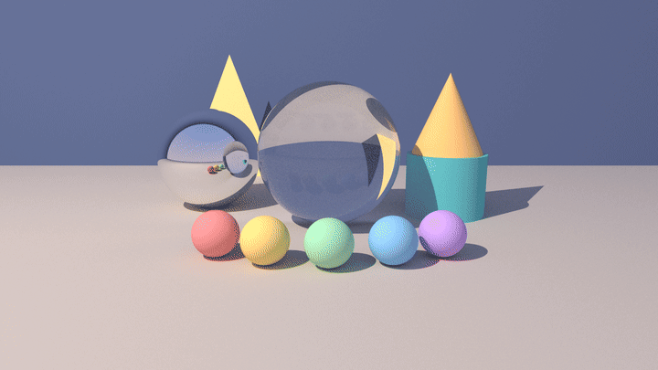
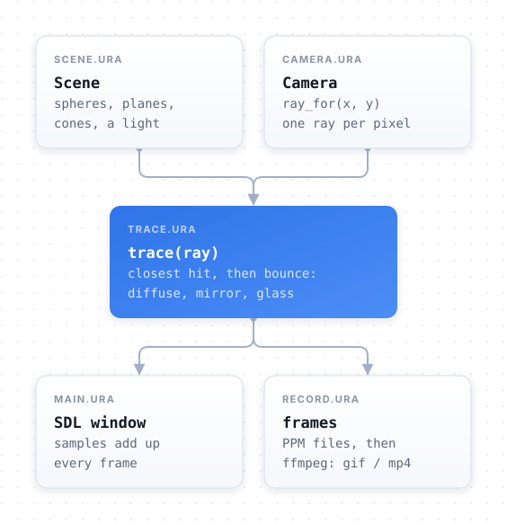

<p align="center">
  
</p>

<h1 align="center">Ura-Raytracer</h1>

<p align="center">
  A path tracer written in <a href="https://github.com/mohammedhrima/ura-lang">ura</a>: glass, mirrors, soft shadows and a live SDL2 window.<br>
  About 870 lines of ura, no C.
</p>

<p align="center">
  
  
  
  
</p>

<p align="center">
  
</p>

<p align="center"><a href="assets/demo.mp4">full 4K video (mp4)</a></p>

---

## Run it

```
git clone https://github.com/mohammedhrima/Ura-Raytracer
cd Ura-Raytracer
ura deps install # clones the ura std libraries into deps/
ura run          # opens the window; the image gets cleaner every frame
```

| key | does |
|---|---|
| arrows | move left, right, up, down |
| page up / page down | move forward / back |
| `r` | reset the camera |
| esc | quit |

Needs SDL2 on your system (`apt install libsdl2-dev` or `brew install sdl2`).

## How a frame is made

<picture>
  <source media="(prefers-color-scheme: dark)" srcset="assets/render-dark.svg">
  
</picture>

Each pixel shoots one ray per frame with a little random jitter. `trace` follows it through up to 5 bounces:

| surface | what the ray does |
|---|---|
| diffuse | picks a random direction, and adds the light it sees from the lamp (with a shadow ray) |
| mirror | reflects |
| glass | refracts, or reflects at grazing angles (Schlick's approximation) |

The window keeps adding samples, so the noise fades away while the camera stands still. Moving resets it.

## The code

```
src/
├── main.ura          the SDL2 window, keys, the accumulation loop
├── config.ura        size, bounces, epsilons
├── math/             Vec3, Ray, mod random
├── shapes/           Shape and its children: Sphere, Plane, Triangle, Rectangle, Cylinder, Cone
├── scene.ura         the objects, the lamp, closest_hit
├── camera.ura        position, yaw / pitch, one ray per pixel
└── trace.ura         bounces, sky, light, pixels
record.ura            renders the video frames without a window
```

Every struct is written the same way: its file holds the data, a folder next to it holds the code.

```
math/
├── vec3.ura              struct Vec3:
│                             x f64
│                             y f64
│                             z f64
│                             use "./vec3/operators"
│                             use "./vec3/methods"
└── vec3/
    ├── operators.ura     operator +(o &Vec3) Vec3 ...
    └── methods.ura       fn dot(o &Vec3) f64 ...
```

`use` inside a struct pastes the file there, so the methods see `self` as if they were written in place.

Some ura in it:

```ura
struct Sphere from Shape:            // takes Shape's material and set_hit, at compile time
    center Vec3
    radius f64

template<T>:                         // one function for every kind of shape
    fn closest_in(shapes &Array<T>, r &Ray, t_min f64, closest &f64, h &Hit):
        for i in Range::create(0, shapes.size()):
            if shapes[i].intersect(r, t_min, closest, h):
                closest = h.t

match m.kind:                        // enum Surface: DIFFUSE, MIRROR, GLASS
    case Surface::MIRROR:
        return r.direction.reflect(h.normal)
```

## Record the video

```
ura record.ura -o build/record
mkdir -p frames
for i in $(seq 0 17); do ./build/record $i 18 & done; wait     # 18 processes share the 72 frames
ffmpeg -framerate 24 -i frames/frame_%03d.ppm -vf scale=3840:2160:flags=lanczos \
       -c:v libx264 -crf 20 -pix_fmt yuv420p demo.mp4
```

`record.ura` swings the camera left and right and adds up 48 samples for each 1280x720 frame. A smaller frame gets clean much faster; ffmpeg then scales it to 4K.

---

<p align="center">
  Built with <a href="https://github.com/mohammedhrima/ura-lang">ura-lang</a>
  and its standard library: <a href="https://github.com/mohammedhrima/ura-core">ura-core</a>,
  <a href="https://github.com/mohammedhrima/ura-posix">ura-posix</a>,
  <a href="https://github.com/mohammedhrima/ura-math">ura-math</a>,
  <a href="https://github.com/mohammedhrima/ura-graphics">ura-graphics</a>
</p>
